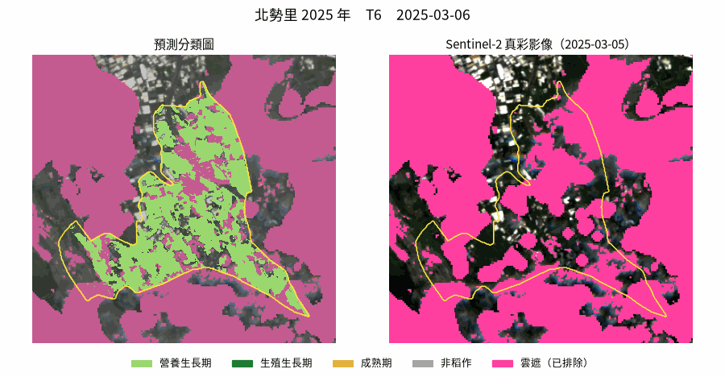
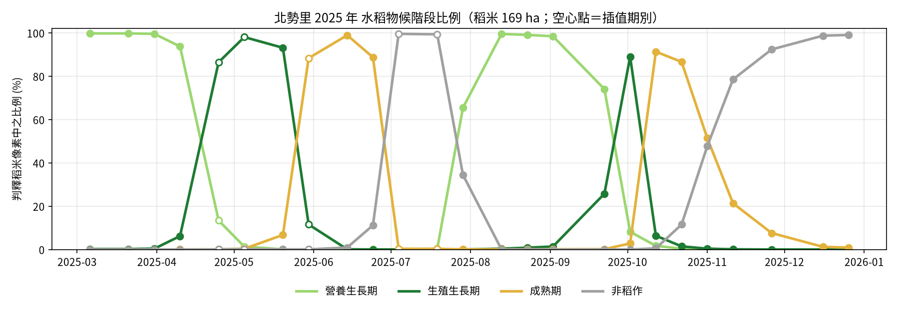
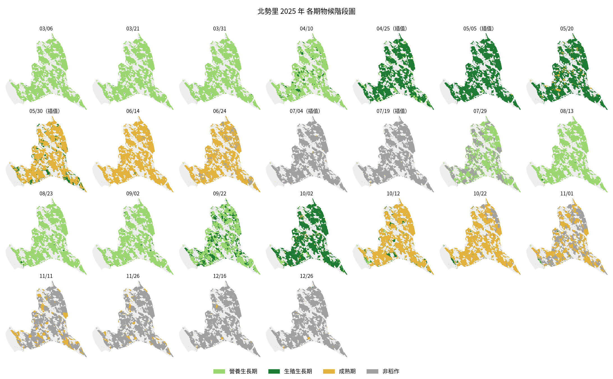

# 霧峰區水稻物候監測

[](https://wufeng-rice-phenology.streamlit.app/)

**線上 Demo：<https://wufeng-rice-phenology.streamlit.app/>**（選北勢里 2025 或 2026 可立即載入）

以 Sentinel-2 時序影像，自動判釋臺中市霧峰區各村里的水稻田，以 LSTM 預測每一期的水稻物候階段（營養生長期／生殖生長期／成熟期／非稻作），並進一步轉換成可供決策的資訊：

- **種了多少稻**：各期作稻作面積、種植型態（一期／二期／兩期皆種）、歷年比較
- **什麼時候收割**：每塊田的插秧、抽穗、收割日，以及未來各週收割面積預報（附回測誤差）
- **哪些田要注意**：生長落後、生長勢偏弱、未進入成熟期之區塊清單，可下載 CSV 供現地巡查

| 使用者 | 可支援之決策 |
|---|---|
| 農糧署／區公所 | 稻作面積統計、休耕與轉作稽核、災害勘查優先順序 |
| 農會／糧商／代耕業者 | 收割機與烘乾廠排程 |
| 農田水利署 | 依插秧時程規劃輪灌與配水 |
| 環保局 | 收割後稻草露天燃燒之稽查時段 |

選擇村里與年份後，網頁會直接以 HTTP 讀取雲端影像中該村里的範圍，全程在記憶體內運算，**不需事先下載任何影像**。



## 流程

```
Planetary Computer STAC（Sentinel-2 L2A）
  │  COG 視窗讀取：只取村里範圍（外擴 300 m），重投影至 EPSG:3826 / 10 m
  ▼
雲遮排除
  │  SCL 逐像素排除雲／雲影／卷雲；村里內晴空比例低於門檻之日期整期剔除
  ▼
30 期時間網格
  │  每期於 ±8 天內挑選最晴之影像（每幅影像只用一次），無影像之期別留待插值
  ▼
非監督稻米判釋
  │  NDVI 物候特徵（最小值、最大值、振幅、上升／下降斜率、峰值時間…）＋ K-means
  │  依「淹水低點 → 陡升 → 峰值」曲線形狀自動建議水稻群集，可手動調整
  ▼
LSTM 物候階段預測
     NDVI / NDWI / RVI → SG 插值補缺 → SG 平滑 → min-max 正規化 ＋ 月份 sin/cos
     以前 5 期為輸入，預測下一期之階段
```

## 成果範例：北勢里 2025 年

一期作與二期作皆可清楚看到「營養生長 → 生殖生長 → 成熟 → 休耕」的循環。





## 網頁功能

| 頁籤 | 內容 |
|---|---|
| 📊 種植概況 | 一期／二期作稻作面積、種植型態地圖、歷年面積與物候日曆比較 |
| 📅 收割時程與預報 | 插秧／抽穗／收割日地圖、每週收割面積與預報；**回測**：只用某日以前的影像預報收割日，與事後判定比較 |
| ⚠️ 巡查清單 | 生長落後／提前、生長勢偏弱、未進入成熟期之區塊地圖與清單（含座標、面積），可下載 CSV |
| 🎞 物候動態 | 各階段比例折線圖；左右對照播放器（預測分類圖 ／ 當期影像），可拖曳期別或自動播放 |
| 🔧 技術細節 | 影像晴空比例與期別配對、各期作 K-means 群集曲線與水稻群集選擇 |

### 收割預報如何運作
1. 由逐期物候階段取得每個像素「首次進入」各階段之日期：營養生長期 ≈ 插秧、成熟期 ≈ 抽穗、成熟後轉為非稻作 ≈ 收割
2. 尚未收割者，以最近已發生之事件加上後續各階段天數推估收割日；天數取前一年同期作之實際中位數
3. 回測時僅以截至日以前之影像重新插值與預測，避免使用未來資訊

北勢里 2025 年回測（截至收割前約 45 天）：一期作平均絕對誤差約 3 天，二期作約 10 天（±15 天內約 8 成）。比較對象為系統事後判定之收割期別，並非地面調查資料。

## 模型

- 架構：2 層 LSTM（128 units）＋ 全連接層，4 類輸出
- 輸入：S2+Month 共 5 個特徵（NDVI、NDWI、RVI、Month_sin、Month_cos），序列長度 5
- 缺值補全：Savitzky–Golay 插值
- 訓練資料：臺中地區 4 個訓練樣區、2 個獨立測試樣區之逐像素物候標註（2023 年）

| 測試樣區 | Accuracy | F1 | Mean IoU |
|---|---|---|---|
| test_area1 | 0.898 | 0.898 | 0.806 |
| test_area2 | 0.861 | 0.860 | 0.739 |

完整指標見 [`models/evaluation_metrics.csv`](models/evaluation_metrics.csv)（含 S1、S1+S2 版本供比較；本 Demo 僅使用光學影像，故採 S2+Month 模型）。

## 執行

需要 Python 3.10 以上，以及可連外的網路（讀取 Planetary Computer 影像）。

```bash
python -m venv .venv
source .venv/bin/activate            # Windows：.venv\Scripts\activate
pip install -r requirements.txt
streamlit run app.py
```

瀏覽器開啟 http://localhost:8501，於左側選擇村里與年份後按「載入影像並分析」。標有 ⚡ 之組合（北勢里 2025、2026）已附預先計算之影像時序，約 20 秒內完成；其餘組合即時讀取雲端影像，約 1–3 分鐘（視村里面積與網路速度而定）。

LSTM 推論以 NumPy 實作（`models/model_S2plusMonth.npz`，與 PyTorch 原模型逐像素結果一致），網頁執行不需安裝 torch。

預先計算歷年資料（展示時可立即載入，並啟用跨年比較與以前一年天數預報）：

```bash
python scripts/precompute.py --village 北勢里 --years 2019 2025
```

結果存於 `cache/`。版本控制中僅納入各年度摘要（`*_summary.json`，供跨年比較與預報天數）及北勢里 2025、2026 之影像時序。

輸出靜態成果圖（README 圖片即由此產生；需另裝 `requirements-dev.txt`）：

```bash
pip install -r requirements-dev.txt
python scripts/export_figures.py --village 北勢里 --year 2025 --out docs --font <中文字型檔.otf>
```

### 部署至 Streamlit Community Cloud

於 [share.streamlit.io](https://share.streamlit.io) 以 GitHub 帳號登入 → Create app → 選擇本 repository、分支 `main`、主程式 `app.py`，Advanced settings 之 Python 版本選 3.12 → Deploy。

## 專案結構

```
app.py                      Streamlit 網頁
pipeline.py                 影像讀取、雲遮、分群、特徵與 LSTM 推論
insights.py                 物候日曆、收割預報與回測、巡查清單、年度摘要
scripts/precompute.py       批次預先計算歷年資料
scripts/export_figures.py   輸出成果圖與 GIF
scripts/convert_model.py    PyTorch 權重轉 NumPy
models/                     模型權重（.pt 原始、.npz 推論用）與評估指標
cache/                      年度摘要與展示用影像時序
wufeng_villages.geojson     霧峰區村里界
docs/                       README 圖片
```

## 限制

- 模型以研究區 2023 年資料訓練；Planetary Computer 之 L2A 產品與訓練所用影像之前處理不完全相同，其他年份與地區之結果僅供參考。
- 事件日期解析度受期別間隔限制（約 10–15 天）。
- 巡查清單為「與同村里其他稻田相比之相對異常」，需現地確認原因。
- 長期連續雲遮（如梅雨季）之期別以插值補齊，預測不確定性較高。

## 資料來源

- Sentinel-2 L2A：Copernicus Sentinel data，經 [Microsoft Planetary Computer](https://planetarycomputer.microsoft.com/) 取得
- 村里界：內政部國土測繪中心 村里界圖（政府資料開放授權條款）
- 底圖：Esri World Imagery、OpenStreetMap

## 授權

程式碼以 [MIT License](LICENSE) 釋出；Sentinel-2 影像與村里界依各自之資料授權條款。
